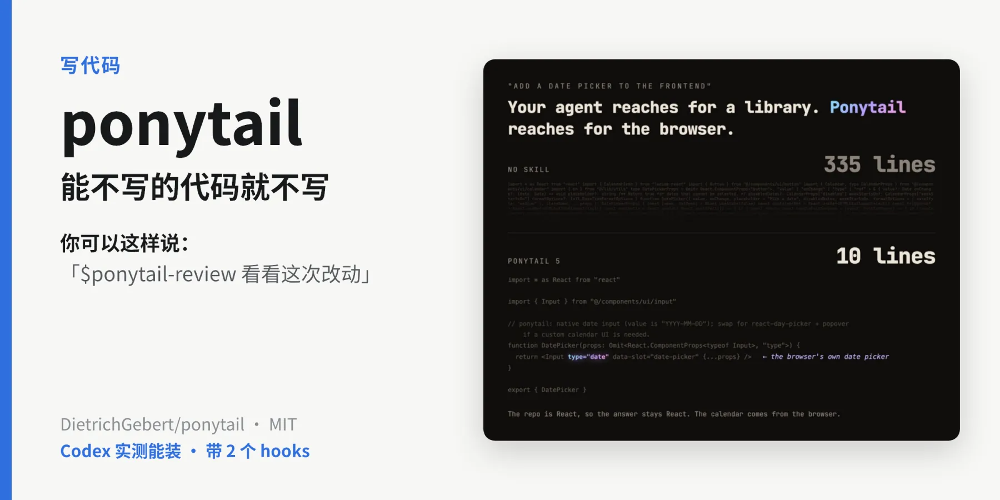
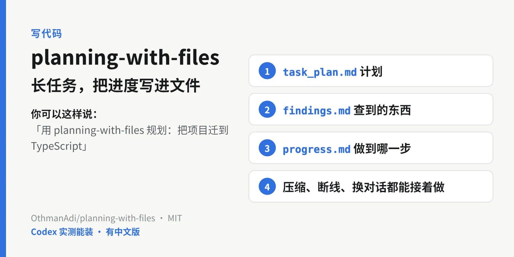
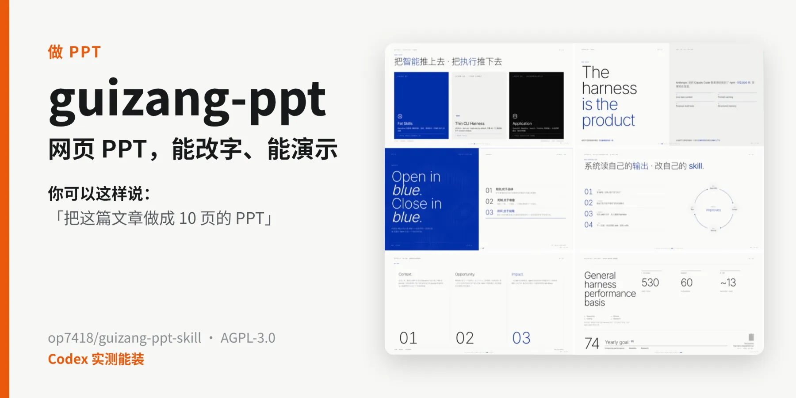
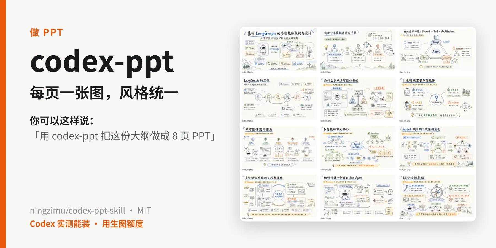
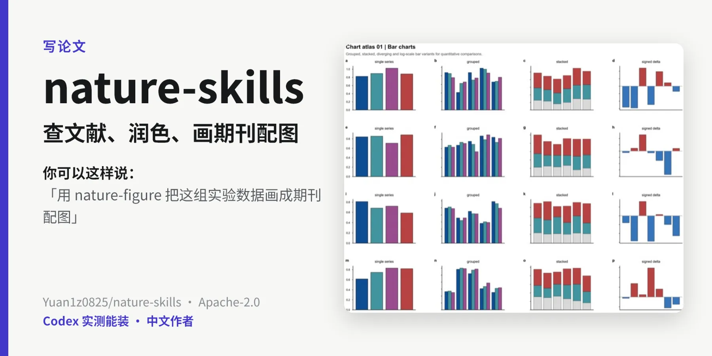
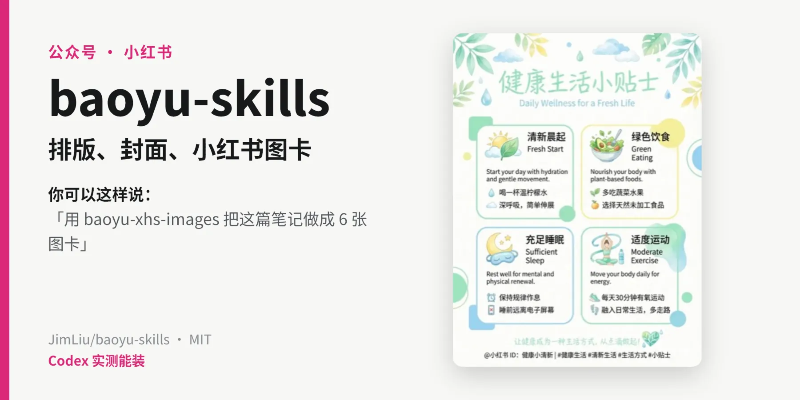
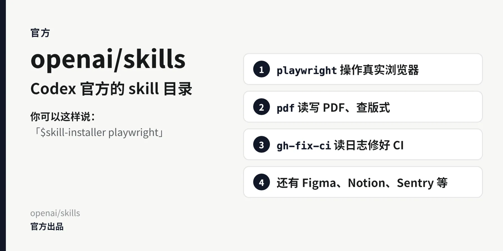

# Codex Skills 中文精选：装上就好用的 skill（2026）

> **最后核对：2026 年 10 月 19 日**（北京时间）· Codex CLI 0.163.0
>
> 每个都看过源码，装进 Codex 确认能认到；能用命令装的，都按页面上的命令重装过。每两周更新一次，觉得有用就点右上角 ⭐ Star。

由 [AONIR](https://aonir.com/?utm_source=github&utm_medium=referral&utm_campaign=codex_skills&utm_content=brand_home) 整理维护。我们提供 ChatGPT 会员充值服务，和 OpenAI 没有隶属关系；这页只讲 Codex 的 skill，充值相关只放在[最后一节](#国内怎么开通-codex)。

第一次在 Codex 里装 skill，先看[安装说明](INSTALL.md)：Codex 认哪几个文件夹、怎么确认装上了、装多了有什么影响。

## 按需求挑

| 我想 | 推荐 | 装上以后，它会怎么做 |
|---|---|---|
| 让 AI 先想清楚再写代码 | [superpowers](#superpowers先想清楚再写代码) | 先问需求、给几种做法让你选、写成计划，每一步先写测试，测试跑过才说做完 |
| 动手前让 AI 把我问清楚 | [mattpocock/skills](#mattpocockskills动手之前先把你问清楚) | 一轮列出一组问题，每题附上建议答案，你点头或者改，问清了才写；还能把项目里的术语记成文档 |
| 别乱加依赖、能少写就少写 | [ponytail](#ponytail能不写的代码就不写) | 写之前先问：真的要吗？项目里有没有？浏览器能不能直接做？作者的例子从 335 行减到 10 行 |
| 大任务做到一半不断线 | [planning-with-files](#planning-with-files长任务把进度写进文件) | 把计划、查到的东西、做到哪一步写进三个文件，上下文压缩了、换了对话也能接着做 |
| 看懂一个陌生项目 | [archify](#archify把代码和想法画成图) | 把整个代码库或一段描述画成架构图、流程图、时序图，浏览器里能点开看细节 |
| 前端做得好看 | [taste-skill / frontend-design](#taste-skill做出来的网页不像-ai-模板) | 给 AI 一套字体、间距、配色的规矩，少出一眼就是 AI 做的模板页 |
| 让 AI 自己打开网页测一遍 | [agent-browser](#agent-browser让-ai-自己开浏览器点一遍) | AI 自己开浏览器点按钮、填表、截图，把注册、下单流程走一遍找 bug |
| 做 PPT | [guizang-ppt](#guizang-ppt网页-ppt能改字能演示) / [codex-ppt](#codex-ppt每页一张图风格统一) | guizang 做能改字、能上台演示的网页 PPT；codex-ppt 每页生成一张图，拼成 PPTX |
| 做视频 | [hyperframes](#hyperframes写网页出-mp4-视频) | 用 HTML 和动画写出每一帧，渲染成 MP4，做产品介绍、字幕短视频、图表动画 |
| 写论文、画科研图 | [nature-skills](#nature-skills写论文和科研绘图) | 查文献、核引用、精读论文、按 Nature 风格润色、画期刊配图，22 个按需装 |
| 中文去 AI 味 | [shuorenhua](#shuorenhua中文去-ai-味) | 删掉「值得注意的是」「简而言之」这类套话，事实和数字一个不动 |
| 公众号、小红书配图 | [baoyu-skills](#baoyu-skills公众号和小红书) | 排版 Markdown、转成公众号能用的 HTML、做封面和小红书图卡 |
| 处理 PDF、修好挂掉的 CI | [OpenAI 官方 skill](#openai-官方目录浏览器pdfgithub) | 读写 PDF 并检查版式；读 GitHub Actions 的日志，把 CI 修好 |

每一条下面的卡片上写了「你可以这样说」。在 Codex 里，可以输入 `$` 加 skill 名字直接叫它，也可以直接说要做什么，Codex 会按 skill 的说明自己挑。

## 本期值得看（10 月 19 日）

这期新收 4 个。[skills.sh](https://www.skills.sh/) 总安装榜的前 11 名，除了第 1 名（skills 命令行自带的 find-skills），全部出自这 4 个仓库：

| 新收 | 能帮你做什么 | skills.sh 总榜（10 月 19 日） |
|---|---|---|
| [mattpocock/skills](#mattpocockskills动手之前先把你问清楚) | 动手前把需求问清楚，测试先行，按步骤排查 bug | grill-me 第 2（139 万次安装），前 11 名里占 6 个 |
| [agent-browser](#agent-browser让-ai-自己开浏览器点一遍) | 让 AI 自己开浏览器点按钮、填表、截图 | 第 4（117 万） |
| [hyperframes](#hyperframes写网页出-mp4-视频) | 用 HTML 和动画写视频，渲染成 MP4 | hyperframes-cli 第 7、hyperframes 第 8 |
| [frontend-design](#taste-skill做出来的网页不像-ai-模板) | Anthropic 出的前端审美规则，和 taste-skill 放在一起 | 第 11（100 万） |

另外，这页的 skill 全装上一共 96 个，我们实测 Codex 已经开始截短说明：48 个较长的说明被截到 240 到 550 字符。挑着装，详见[安装说明](INSTALL.md#装多了会怎样)。

已收录的有一处变化：taste-skill 作者 10 月 19 日发了 2.1.1 版，`npx skills add` 暂时装不上，装法改成了 Codex 插件。

## 写代码

### superpowers：先想清楚，再写代码

<a href="https://github.com/obra/superpowers"></a>

[](https://github.com/obra/superpowers) [](https://github.com/obra/superpowers/commits) [](https://www.skills.sh/obra/superpowers)

你说「帮我加个导出功能」，没装它的 Codex 多半直接开始改。装了它，Codex 会先问你几个问题、给出两三种做法让你选，把方案写成计划，再按计划一步步做，每一步先写测试，最后跑过测试才说做完。修 bug 也有专门的流程：先复现、找到原因再改。

适合要改好几个文件的功能，或者一个查了很久的 bug。改一行配置、问个用法就不用开它，它会坚持先讨论、先写计划。

装法：它在 OpenAI 官方的插件市场里。桌面版左边栏 Plugins → Coding → Superpowers → 点 `+`；CLI 里输入 `/plugins`，搜 `superpowers` 安装。

15 个 skill 各管什么、哪些可以关掉、在 Codex 里要开的开关，见[深度解读](deep-dives/superpowers.md)。

### mattpocock/skills：动手之前，先把你问清楚

<a href="https://github.com/mattpocock/skills"></a>

[](https://github.com/mattpocock/skills) [](https://github.com/mattpocock/skills/commits) [](https://www.skills.sh/mattpocock/skills)

TypeScript 讲师 Matt Pocock 自己每天用的一套。最出名的是 grill（拷问）：你说要做什么，它一轮列出一组问题，每题附上它建议的答案，你回 yes 或者改，问到没有含糊的地方才动手。`grill-with-docs` 还会边问边把项目里的术语记进 `GLOSSARY.md`、把重要决定记下来，下次 AI 读这些文件就懂你的说法。

另外几个常用的：测试先行的 `tdd`、分阶段排查的 `diagnosing-bugs`、找架构问题并出一份 HTML 报告的 `improve-codebase-architecture`、把当前对话整理成交接文档的 `handoff`。

和 superpowers 是两种路子：superpowers 把整个流程管起来，这套是一个个小工具，你自己挑时候用。两套里都有测试先行和排查 bug 的 skill，挑一套装就好。

```bash
codex plugin marketplace add mattpocock/skills
codex plugin add mattpocock-skills@mattpocock
```

插件在 Codex 启动时自己更新。`grill-with-docs`、`handoff`、`to-spec` 这些有十几个不会自己触发，要你手动叫：在 Codex 里用 `/skills` 或输入 `$` 找到它。用 `triage`、`to-tickets` 这类管任务的之前，作者要求先运行一次 `setup-matt-pocock-skills`。

### ponytail：能不写的代码就不写

<a href="https://github.com/DietrichGebert/ponytail"></a>

[](https://github.com/DietrichGebert/ponytail) [](https://github.com/DietrichGebert/ponytail/commits) [](https://www.skills.sh/DietrichGebert/ponytail)

AI 写代码前先过几道问题：这东西真的要吗？项目里是不是已经有了？浏览器、标准库能不能直接做？图里是作者给的例子，同样是「加一个日期选择器」，没装时 AI 写了 335 行，装了以后用浏览器自带的日期输入框，10 行。

另外带三个命令：`$ponytail-review` 审当前改动，`$ponytail-audit` 审整个仓库，`$ponytail-debt` 把代码里标了 `shortcut:` 的地方收成一张待还清单。

```bash
codex plugin marketplace add DietrichGebert/ponytail
codex plugin add ponytail@ponytail
```

它带两个 hooks（会自动运行的小脚本）。装完在 Codex 里打开 `/hooks`，看过脚本再确认，然后开一个新对话。

### planning-with-files：长任务，把进度写进文件

<a href="https://github.com/OthmanAdi/planning-with-files"></a>

[](https://github.com/OthmanAdi/planning-with-files) [](https://github.com/OthmanAdi/planning-with-files/commits) [](https://www.skills.sh/OthmanAdi/planning-with-files)

做多步骤的大任务时，让 AI 把计划、查到的东西、做到哪一步分别写进 `task_plan.md`、`findings.md`、`progress.md`。Codex 的长会话经常要压缩上下文，压缩完、断了、换个对话，它都能从这几个文件里接着做。

适合一次要跑几十步、跨好几个对话的任务。仓库里还有中文版（`planning-with-files-zh`）。

```bash
npx skills add OthmanAdi/planning-with-files --skill planning-with-files --agent codex -g --yes
```

想要它自动提醒和收尾检查，还可以装它的 hooks，步骤见作者的 [Codex 说明](https://github.com/OthmanAdi/planning-with-files/blob/main/docs/codex.md)。

## 看项目、做网页、测网页

### archify：把代码和想法画成图

<a href="https://github.com/tt-a1i/archify"></a>

[](https://github.com/tt-a1i/archify) [](https://github.com/tt-a1i/archify/commits) [](https://www.skills.sh/tt-a1i/archify)

把一段描述、一个计划或者整个代码库画成图：架构图、流程图、时序图、数据流、状态机、ER 图都行。输出一个 HTML 文件，浏览器打开，节点能点开看细节，能切深色浅色。

接手陌生项目、想先看清结构时最有用，写文档配图、给不懂代码的人讲方案也用得上。

```bash
npx skills add tt-a1i/archify --skill archify --agent codex -g --yes --copy
```

要 Node.js 18 以上。中文说明见仓库里的 `README_ZH.md`。

### taste-skill：做出来的网页不像 AI 模板

<a href="https://github.com/Leonxlnx/taste-skill"></a>

[](https://github.com/Leonxlnx/taste-skill) [](https://github.com/Leonxlnx/taste-skill/commits) [](https://www.skills.sh/Leonxlnx/taste-skill)

给 AI 一套做网页的审美规则，字体、间距、配色、版式往成熟设计靠，少出那种一眼就是 AI 生成的渐变卡片页。仓库里有十几个风格变体，默认的叫 `design-taste-frontend`。适合落地页、个人站、产品介绍页。

```bash
codex plugin marketplace add Leonxlnx/taste-skill
codex plugin add taste-skill@taste-skill
```

装完开一个新对话。要 Node 22 以上，电脑上要有 Chrome、Edge 或 Chromium；找配图要联网。作者 10 月 19 日发的 2.1.1 版，用 `npx skills add` 装会因为说明的格式报错被跳过，先用上面的插件装法。

Anthropic 出的 [frontend-design](https://github.com/anthropics/skills/tree/main/skills/frontend-design)（Apache-2.0）是同一类，规则短得多：正文约 9,400 字符，taste-skill 约 38,400。想先试个轻的，装这个：

```bash
npx skills add anthropics/skills --skill frontend-design --agent codex -g --yes
```

### agent-browser：让 AI 自己开浏览器点一遍

<a href="https://github.com/vercel-labs/agent-browser"></a>

[](https://github.com/vercel-labs/agent-browser) [](https://github.com/vercel-labs/agent-browser/commits) [](https://www.skills.sh/vercel-labs/agent-browser)

Vercel 出的浏览器命令行，专门给 AI 用。AI 打开网页后先读出页面结构，给按钮、输入框编上号（`@e1`、`@e2`），再按编号去点、去填，最后截图，还能对比改动前后的截图。读的是精简过的页面结构，不用每一步都传截图。

写完前端让它自己把注册、下单流程走一遍、找 bug，最常用。

```bash
npm install -g agent-browser
npx skills add vercel-labs/agent-browser --agent codex -g --yes
```

skill 只是个入口，真正干活的是 `agent-browser` 命令，两样都要装。电脑上有 Chrome 会直接用；没有的话运行 `agent-browser install` 下载一个，这一步要能访问 Google。它的说明里要求优先用它，已经在用 OpenAI 官方 `playwright` 的，两个留一个就行。

## 做 PPT 和视频

### guizang-ppt：网页 PPT，能改字、能演示

<a href="https://github.com/op7418/guizang-ppt-skill"></a>

[](https://github.com/op7418/guizang-ppt-skill) [](https://github.com/op7418/guizang-ppt-skill/commits) [](https://www.skills.sh/op7418/guizang-ppt-skill)

做出来是一个 HTML 文件，横向翻页，带演讲者视图、讲稿备注和计时，文字都能改。在 Codex 里还会问你要不要用 GPT-Image 配图，也能顺手出公众号、小红书封面。要能改字、要上台演示，选它。

```bash
npx skills add https://github.com/op7418/guizang-ppt-skill --skill guizang-ppt-skill --agent codex -g --yes
```

许可证是 AGPL-3.0，自己用没问题；改了它的代码再拿去对外提供服务，要按 AGPL 公开改动。

### codex-ppt：每页一张图，风格统一

<a href="https://github.com/ningzimu/codex-ppt-skill"></a>

[](https://github.com/ningzimu/codex-ppt-skill) [](https://github.com/ningzimu/codex-ppt-skill/commits) [](https://www.skills.sh/ningzimu/codex-ppt-skill)

每一页直接生成成一张图，再拼成 PPTX，风格统一。要每页都好看、拿去发图，选它。文字不能直接改，要改字可以再用作者的 [image-to-editable-ppt-skill](https://github.com/ningzimu/image-to-editable-ppt-skill) 转回可编辑的 PPT。

```bash
npx -y skills@latest add ningzimu/codex-ppt-skill --skill codex-ppt --agent codex --global --yes
```

每页都要生成图片，会用到图片生成的额度。

### hyperframes：写网页，出 MP4 视频

<a href="https://github.com/heygen-com/hyperframes"></a>

[](https://github.com/heygen-com/hyperframes) [](https://github.com/heygen-com/hyperframes/commits) [](https://www.skills.sh/heygen-com/hyperframes)

HeyGen 开源的视频框架：AI 用 HTML、CSS 和动画把每一帧写出来，再渲染成 MP4。产品介绍、把 PR 做成讲解视频、数据图表动画、带字幕的短视频都能做，图里是它自带的一个设计模板。

`hyperframes` 是总入口：你说要做什么视频，它先跟你确认需求，再挑对应的流程。

```bash
npx hyperframes skills update
```

这条装的是核心 10 个，做具体某一类视频时它会再装对应的流程，也会顺手给 Claude Code 装一份。要 Node.js 22 以上和 FFmpeg。OpenAI 官方插件市场里也有 HyperFrames，但里面还是旧版的 5 个 skill，建议用上面这条命令。

10 个的说明加起来让清单多 6,900 字符，不做视频的时候可以[停用](INSTALL.md#怎么关怎么卸)。

## 论文和写作

### nature-skills：写论文和科研绘图

<a href="https://github.com/Yuan1z0825/nature-skills"></a>

[](https://github.com/Yuan1z0825/nature-skills) [](https://github.com/Yuan1z0825/nature-skills/commits) [](https://www.skills.sh/Yuan1z0825/nature-skills)

中文作者做的一整套科研 skill，22 个：查文献、核引用、精读论文出阅读卡、按 Nature 风格润色、画期刊配图、论文转中文 PPT、写数据可用性声明，还能把论文改成专利草稿。

一次别全装，用到哪个装哪个。比如只要画图：

```bash
npx skills add Yuan1z0825/nature-skills --agent codex --skill nature-figure --yes --copy
```

这条装进当前项目；加 `--global` 就所有项目都能用。装 `nature-writing`、`nature-polishing`、`nature-reader`、`nature-paper2ppt` 时，要把 `nature-shared` 一起装上。

### shuorenhua：中文去 AI 味

<a href="https://github.com/MrGeDiao/shuorenhua"></a>

[](https://github.com/MrGeDiao/shuorenhua) [](https://github.com/MrGeDiao/shuorenhua/commits) [](https://www.skills.sh/MrGeDiao/shuorenhua)

改写中文，去掉模板腔，事实和数字一个不丢，图里是作者给的例子。写 README、公众号、周报、产品说明时用得上，也可以只标出问题不改。在你的项目根目录运行：

```bash
git clone --depth 1 https://github.com/MrGeDiao/shuorenhua.git /tmp/shuorenhua
mkdir -p .agents/skills/shuorenhua/references
cp /tmp/shuorenhua/SKILL.md .agents/skills/shuorenhua/
cp /tmp/shuorenhua/references/editing-guide.md /tmp/shuorenhua/references/examples.md .agents/skills/shuorenhua/references/
```

英文用 [blader/humanizer](https://github.com/blader/humanizer)（MIT），按维基百科总结的「AI 写作迹象」改英文：`npx skills add blader/humanizer --global --agent codex --yes`。

### baoyu-skills：公众号和小红书

<a href="https://github.com/JimLiu/baoyu-skills"></a>

[](https://github.com/JimLiu/baoyu-skills) [](https://github.com/JimLiu/baoyu-skills/commits) [](https://www.skills.sh/JimLiu/baoyu-skills)

宝玉（JimLiu）的一组内容创作 skill：排版 Markdown、转成公众号能用的 HTML、生成封面和文章配图、小红书图卡、信息图、漫画。作者也建议别全装，做公众号、小红书常用这四个：

```bash
npx skills add jimliu/baoyu-skills --agent codex -g \
  --skill baoyu-format-markdown --skill baoyu-markdown-to-html \
  --skill baoyu-cover-image --skill baoyu-xhs-images --yes
```

出图在 Codex 里会用自带的 `imagegen`，用的是你的额度。

## OpenAI 官方目录：浏览器、PDF、GitHub

<a href="https://github.com/openai/skills"></a>

[](https://github.com/openai/skills) [](https://github.com/openai/skills/commits) [](https://www.skills.sh/openai/skills)

Codex 自带 5 个：画图的 `imagegen`、查官方文档的 `openai-docs`、做插件的 `plugin-creator`、做 skill 的 `skill-creator`、装 skill 的 `skill-installer`。另外有 39 个精选的可以按需装，这几个最常用：

| skill | 能帮你做什么 |
|---|---|
| `playwright` | 在终端里操作真实浏览器：填表、点按钮、截图、调试页面 |
| `pdf` | 读 PDF、生成 PDF，按页渲染出来检查版式 |
| `gh-fix-ci` | GitHub Actions 挂了，让它读日志、修好 |
| `security-best-practices` | 按你用的语言和框架做安全检查 |

用 Figma、Linear、Notion、Sentry 的，也各有对应的一组。在 Codex 里输入：

```text
$skill-installer playwright
```

playwright 要电脑上有 Node.js；pdf 会装几个 Python 库，渲染页面要 Poppler。

## 深度解读

- [superpowers 在 Codex 里怎么用：15 个 skill 拆开看，哪些值得留](deep-dives/superpowers.md)

## 这页怎么更新

- 收什么：源码看过，按页面上的命令在 Codex 里装过、能认到，对用 Codex 的中文用户真有用处。GitHub 星数和 skills.sh 安装量用来找候选，不是收录的理由。
- 多久一次：每两周核一次星数、版本、安装命令和图片，新收的写进「本期值得看」。卡片上的徽章自动更新，不用等我们改。
- 什么时候撤：装不上了、作者不再维护，或者出现了明显更好的同类。撤下和改动都记在[更新日志](CHANGELOG.md)。

## 国内怎么开通 Codex

用 Codex 要有 ChatGPT 的套餐。Free 和 Go 只能在桌面版用少量的 GPT-5.6 Terra、GPT-6 Luna；GPT-6.1 Sol、Astra 和 CLI 要 Plus 起步。没有海外卡，可以微信付款，由 AONIR 充值到你自己的账号：

| 套餐 | 微信付款 | 官方价 | Codex 额度 |
|---|---|---|---|
| [ChatGPT Plus](https://aonir.com/chatgpt-plus/?utm_source=github&utm_medium=referral&utm_campaign=codex_skills&utm_content=cta_plus) | ¥168 / 月 | $20 | 基准，每 5 小时和每周各有上限 |
| [ChatGPT Pro 100](https://aonir.com/chatgpt-pro/?utm_source=github&utm_medium=referral&utm_campaign=codex_skills&utm_content=cta_pro_5x) | ¥730 / 月 | Pro 100，$100 | 约为 Plus 的 10 倍 |
| [ChatGPT Pro 200](https://aonir.com/chatgpt-pro-200/?utm_source=github&utm_medium=referral&utm_campaign=codex_skills&utm_content=cta_pro_10x) | ¥1400 / 月 | Pro 200，$200 | 约为 Plus 的 20 倍 |
| [ChatGPT Pro 500](https://aonir.com/chatgpt-pro-500/?utm_source=github&utm_medium=referral&utm_campaign=codex_skills&utm_content=cta_pro_500) | ¥3500 / 月，客服开通 | Pro 500，$500 | 约为 Plus 的 50 倍 |

美国时间 10 月 29 日起，Pro 三档的 Work / Codex 额度翻倍，Plus 不变（[OpenAI 帮助中心](https://help.openai.com/en/articles/9793128-about-chatgpt-pro-tiers)、[Codex 负责人 Tibo](https://x.com/thsottiaux/status/2115850175868727621)）。

Codex 装不上、登录不了、报错，看我们另一个仓库：[Codex 国内使用与报错速查](https://github.com/Avarce/codex-china-guide)。

## 推荐一个 skill

觉得哪个 skill 该收、哪条写得不对，[开一个 Issue](../../issues/new)：贴上仓库链接、你用它做什么、在 Codex 里装没装上。我们看过源码、装一遍之后补进来，记在[更新日志](CHANGELOG.md)里。

## 转载与许可

本页文字采用 [CC BY 4.0](LICENSE) 许可：可以转载、翻译、改编，注明出处并附上本仓库链接即可。卡片里的效果图和文中的 skill 都归原作者所有，以各自仓库的许可证为准。Codex、ChatGPT、OpenAI 是 OpenAI 的商标，本仓库与 OpenAI 没有隶属关系。
